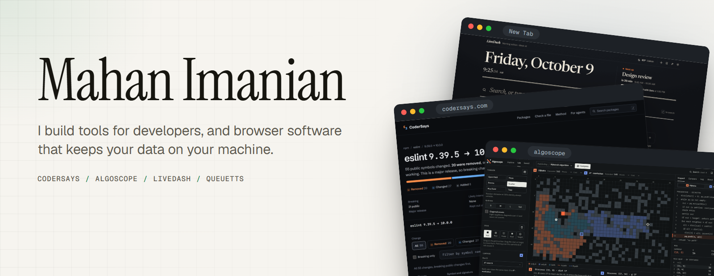
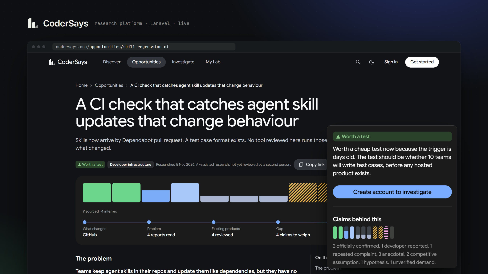
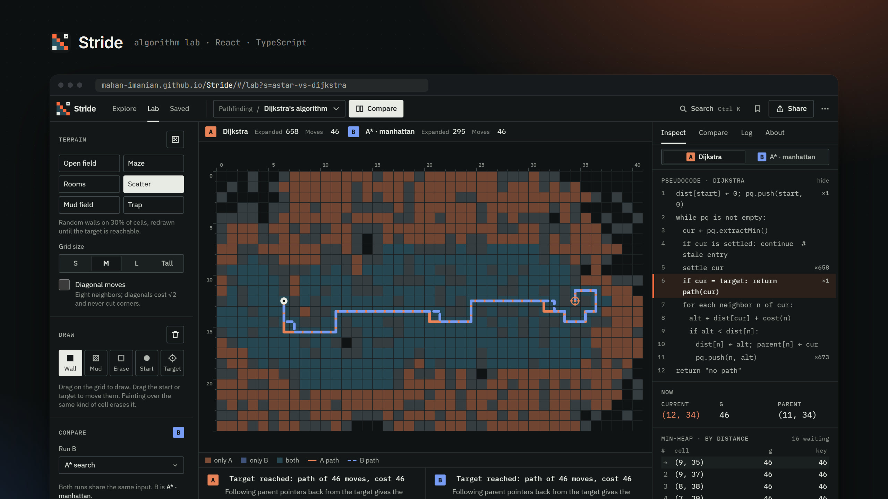
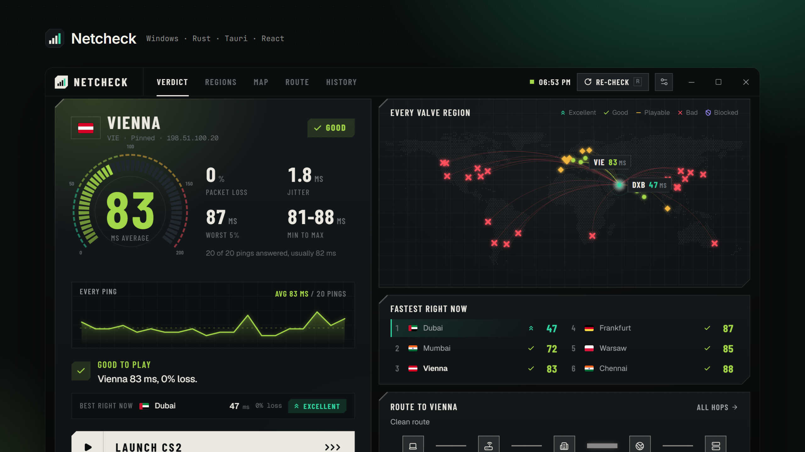
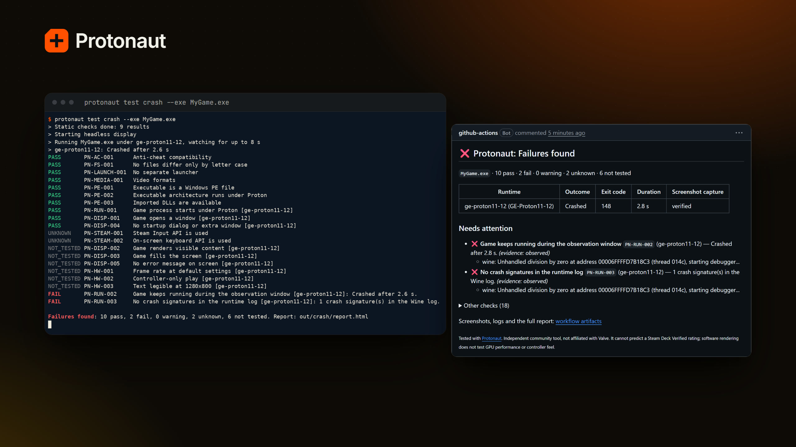
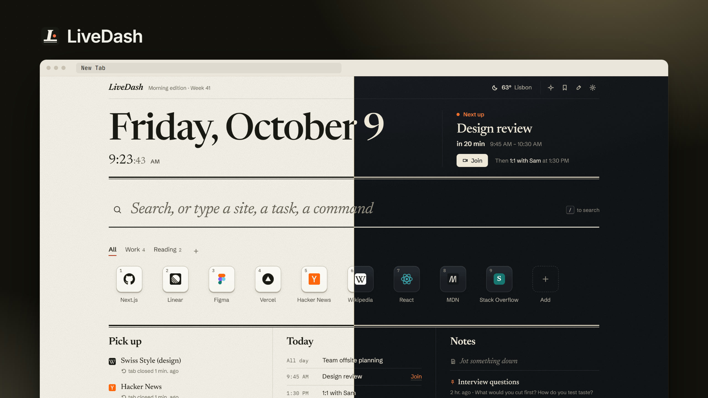
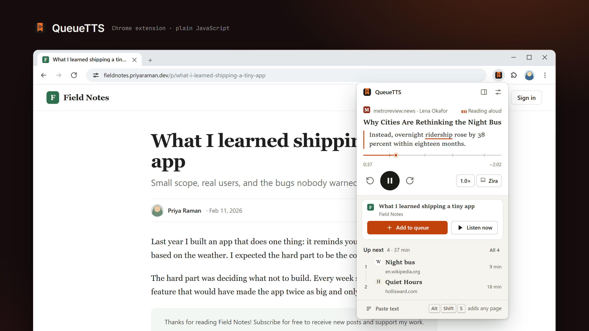

<picture>
  <source media="(prefers-color-scheme: dark)" srcset="assets/banner-dark.png">
  
</picture>

I'm Mahan, founder of GreenTouch, a cleantech startup. I study computer science and AI, have built websites for freelance clients since 2023, and made Roblox games before any of that. Most of what I ship now is developer tooling and software that runs in the browser.

<a href="https://codersays.com">codersays.com</a> · <a href="https://www.linkedin.com/in/mahan-imanian">LinkedIn</a>

 

### [CoderSays](https://codersays.com)

Research for deciding what to build next. Changelogs and public code go in; claims come out tagged by whether a source states them or they are inference. Each opportunity ends in a verdict, and most of those are refusals, published with the working shown.

<b>Live</b> at <a href="https://codersays.com">codersays.com</a> · Laravel

  

### [Stride](https://github.com/Mahan-Imanian/Stride)

An algorithm lab that records every operation of a run and plays it back beside the queue, heap or call stack behind it. Two algorithms can run on the same input, so their counts compare directly.

<a href="https://mahan-imanian.github.io/Stride/"><b>Live demo</b></a> · 18 algorithms, each tested against a reference implementation · React, TypeScript, Vite · MIT

  

### [Netcheck](https://github.com/Mahan-Imanian/netcheck)

Pings every Counter-Strike 2 server region before you queue, with jitter and packet loss for each, then traces the route to the fastest one. Usually enough to tell whether the lag is your Wi-Fi, your ISP or the link out of the country.

<a href="https://github.com/Mahan-Imanian/netcheck/releases/latest"><b>Download</b></a> · Windows 11 · Rust, Tauri, React, TypeScript · MIT

  

### [Protonaut](https://github.com/Mahan-Imanian/protonaut)

Runs a Windows game build under GE-Proton in CI. If a change makes the game crash or render black, the pull request goes red with screenshots and logs attached, no Steam Deck required. Independent project, not affiliated with Valve.

<a href="https://mahan-imanian.github.io/protonaut/"><b>Website</b></a> · <a href="https://github.com/Mahan-Imanian/protonaut-demo/pull/1">Live demo PR</a> · Rust · Apache-2.0

  

### [LiveDash](https://github.com/Mahan-Imanian/LiveDash)

A Chrome new tab laid out like a newspaper: the date as the headline, the next meeting as the lead story, and a search line that checks the tabs already open before it checks the web. Nothing goes online unless you turn it on.

Chrome extension · React, TypeScript, WXT · MIT

  

### [QueueTTS](https://github.com/Mahan-Imanian/QueueTTS)

Save an article with a shortcut and it joins a queue to be read aloud, in order, using the voices already on the machine. Close the tab or restart the browser and it resumes at the sentence you left.

Chrome extension · no host permissions · plain JavaScript · end-to-end tested in Chrome

 

Open to collaboration on developer tools, browser software and CS / AI work · <a href="https://www.linkedin.com/in/mahan-imanian">LinkedIn</a>

