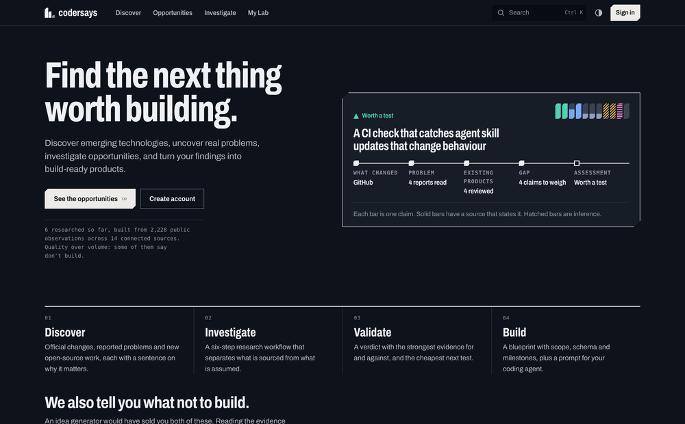
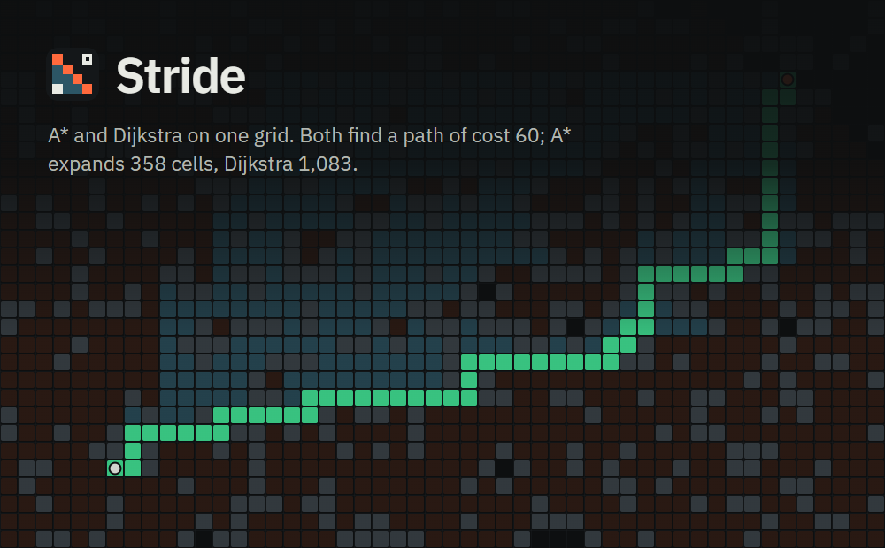
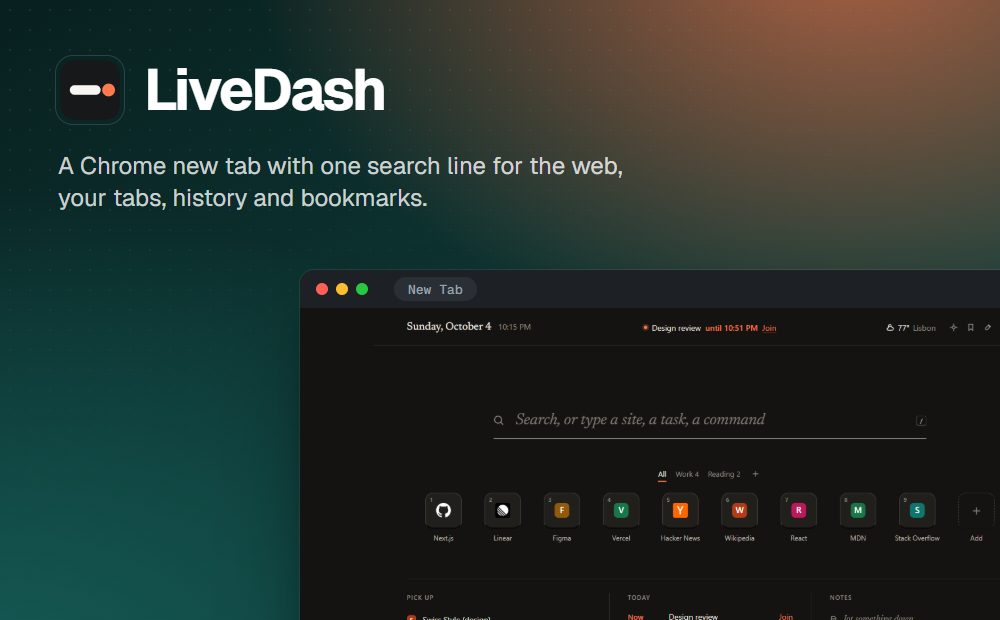
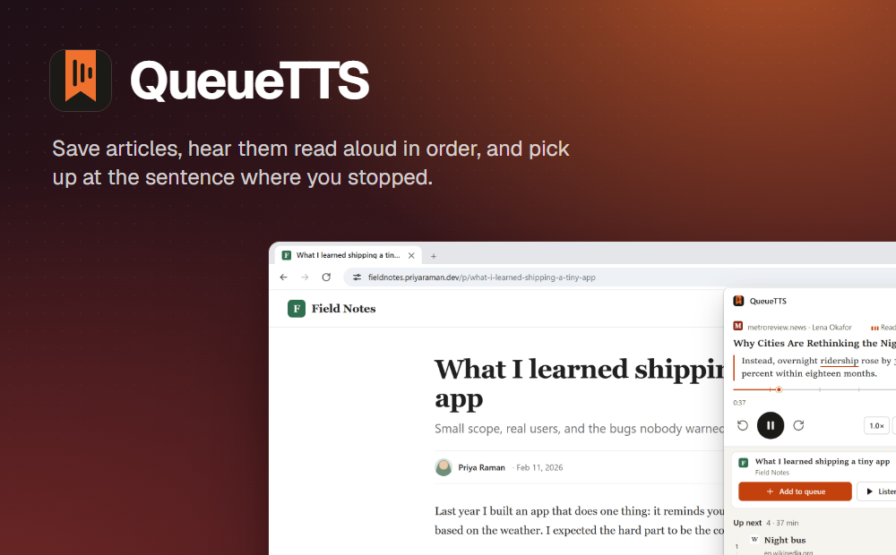
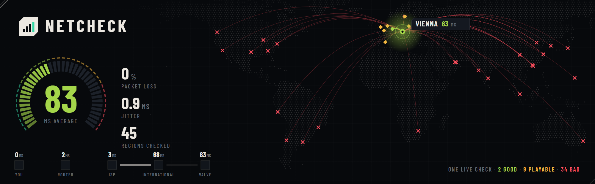
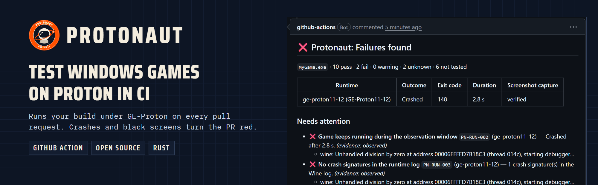

<picture>
  <source media="(prefers-color-scheme: dark)" srcset="assets/banner-dark.png">
  
</picture>

  
  
  

I'm Mahan, founder of GreenTouch, a cleantech startup. I study computer science and AI, have built websites for freelance clients since 2023, and made Roblox games before any of that. Most of what I ship now is developer tooling and software that runs in the browser.

## Projects

<table>
  <tr>
    <td width="50%" valign="top">
      
      <h3><a href="https://codersays.com">CoderSays</a></h3>
      
Research for deciding what to build next. Official changes, reported problems and new open-source work go through a six-step investigation that keeps sourced claims apart from inference. Each one ends in a verdict, the cheapest test to run next, and a build plan.

      
<b>Live</b> · 6 opportunities researched from 2,228 public observations across 14 connected sources

    </td>
    <td width="50%" valign="top">
      
      <h3><a href="https://github.com/Mahan-Imanian/stride">Stride</a></h3>
      
An algorithm visualiser that replays every operation beside the queue, heap or call stack behind it. Run two algorithms on the same input and it finds the first step where they diverge.

      
<a href="https://mahan-imanian.github.io/stride/"><b>Live demo</b></a> · 18 algorithms, each tested against a reference implementation · React, TypeScript, Vite

    </td>
  </tr>
  <tr>
    <td width="50%" valign="top">
      
      <h3><a href="https://github.com/Mahan-Imanian/LiveDash">LiveDash</a></h3>
      
A Chrome new tab laid out like a newspaper: the date as the headline, the next meeting as the lead story, and a search line that checks the tabs already open before it checks the web. Nothing goes online unless you turn it on.

      
Chrome extension · React, TypeScript, WXT · MIT

    </td>
    <td width="50%" valign="top">
      
      <h3><a href="https://github.com/Mahan-Imanian/QueueTTS">QueueTTS</a></h3>
      
Save an article with a shortcut and it joins a queue to be read aloud, in order, using the voices already on the machine. Close the tab or restart the browser and it resumes at the sentence you left.

      
Chrome extension · no host permissions · plain JavaScript · end-to-end tested in Chrome

    </td>
  </tr>
  <tr>
    <td colspan="2" valign="top">
      
      <h3><a href="https://github.com/Mahan-Imanian/netcheck">Netcheck</a></h3>
      
Pings every Counter-Strike 2 server region before you queue, with jitter and packet loss for each, then traces the route to the fastest one. Usually enough to tell whether the lag is your Wi-Fi, your ISP or the link out of the country.

      
<a href="https://github.com/Mahan-Imanian/netcheck/releases/latest"><b>Download</b></a> · Windows 11 · Rust, Tauri, React, TypeScript · MIT

    </td>
  </tr>
  <tr>
    <td colspan="2" valign="top">
      
      <h3><a href="https://github.com/Mahan-Imanian/protonaut">Protonaut</a></h3>
      
Runs a Windows game build under GE-Proton in CI. If a change makes the game crash or render black, the pull request goes red with screenshots and logs attached, no Steam Deck required. Independent project, not affiliated with Valve.

      
<a href="https://mahan-imanian.github.io/protonaut/"><b>Website</b></a> · <a href="https://github.com/Mahan-Imanian/protonaut-demo/pull/1">Live demo PR</a> · Rust · Apache-2.0

    </td>
  </tr>
</table>

 

Open to collaboration on developer tools, browser software and CS / AI work · <a href="https://www.linkedin.com/in/mahan-imanian">LinkedIn</a>

