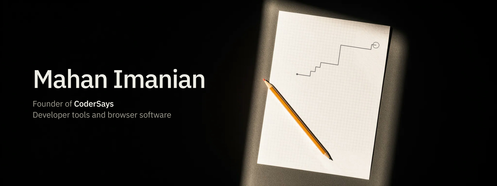
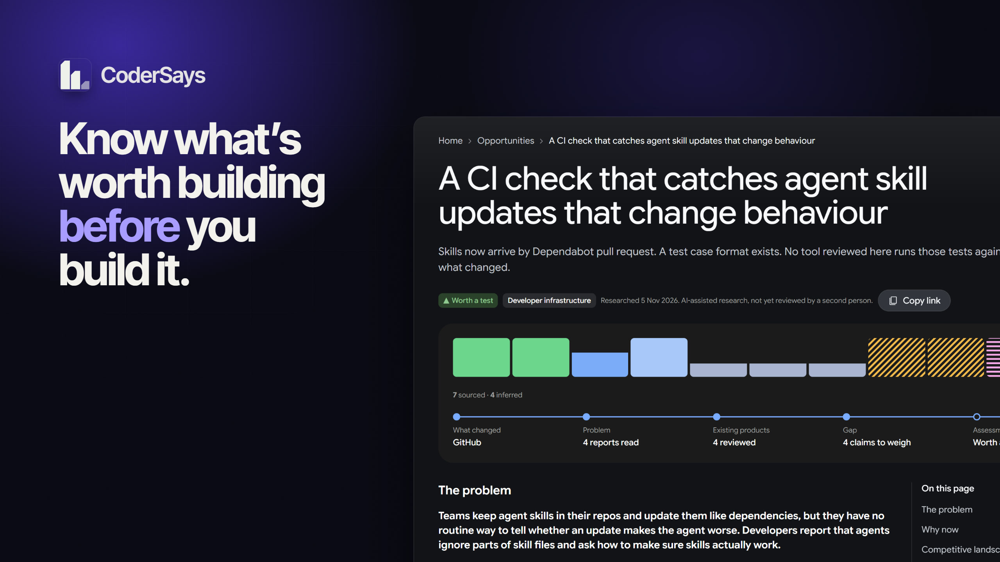
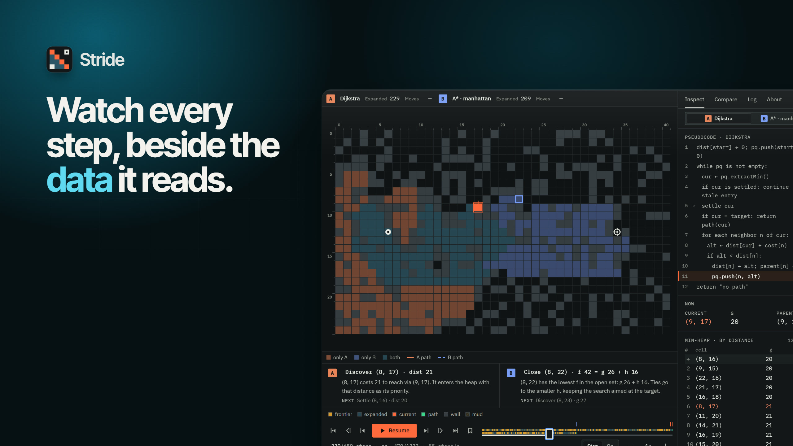
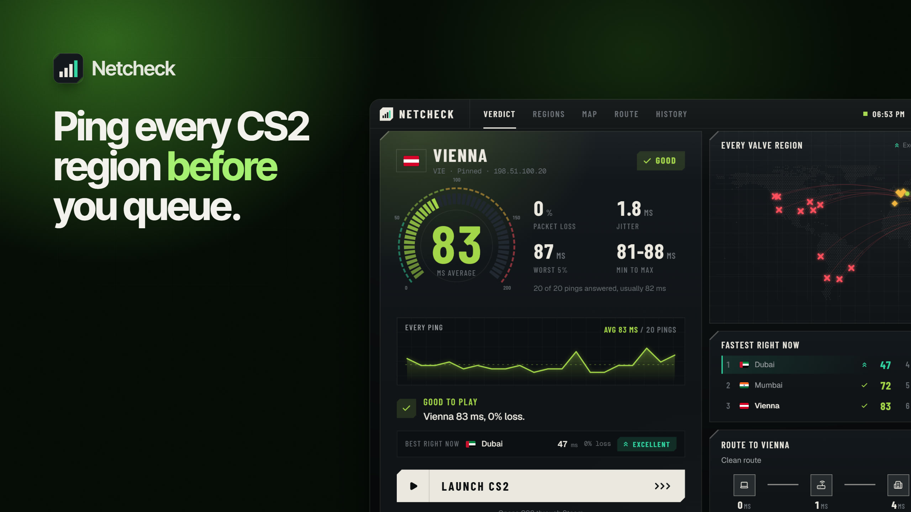
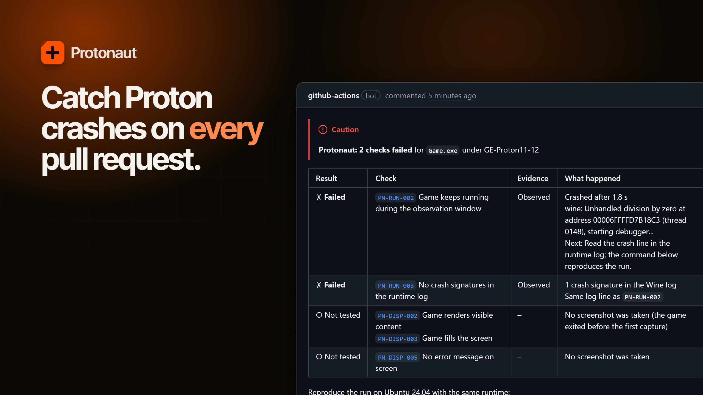
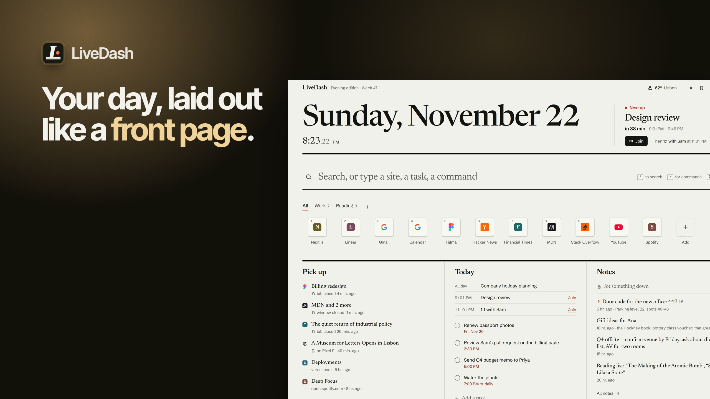
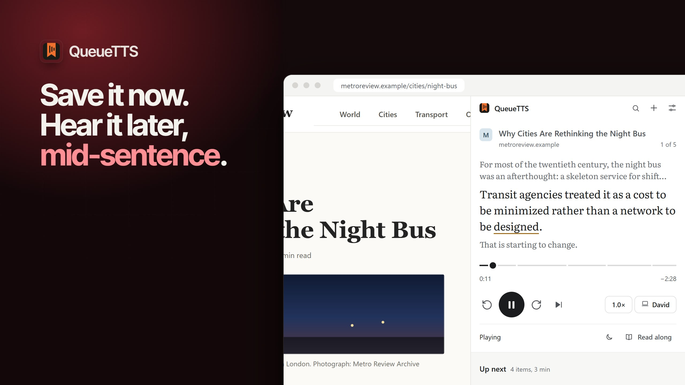

Hi, stranger! I'm Mahan. I spend most of my time building tools for developers and businesses. A sucker for computer science and AI. Been happily building SaaS & PaaS products for clients since 2021 :D

<a href="https://codersays.com">codersays.com</a> · <a href="https://www.linkedin.com/in/mahan-imanian">LinkedIn</a>

 

<table>
  <tr>
    <td width="50%" valign="top">
      
      <h3><a href="https://codersays.com">CoderSays</a></h3>
      
Research for deciding what to build next. Changelogs and public code go in; claims come out tagged by whether a source states them or they are inference. Each opportunity ends in a verdict, and most of those are refusals, published with the working shown.

      
<b>Live</b> at <a href="https://codersays.com">codersays.com</a> · Laravel

    </td>
    <td width="50%" valign="top">
      
      <h3><a href="https://github.com/Mahan-Imanian/Stride">Stride</a></h3>
      
An algorithm lab for lectures and self-study. It records every step of a run and plays it back beside the queue, heap or call stack, and two algorithms can run on the same input to compare their counts.

      
<a href="https://mahan-imanian.github.io/Stride/"><b>Live demo</b></a> · 18 algorithms, each tested against a reference implementation · React, TypeScript, Vite · MIT

    </td>
  </tr>
  <tr>
    <td width="50%" valign="top">
      
      <h3><a href="https://github.com/Mahan-Imanian/netcheck">Netcheck</a></h3>
      
Pings every Counter-Strike 2 server region before you queue, with jitter and packet loss for each, then traces the route to the fastest one. Usually enough to tell whether the lag is your Wi-Fi, your ISP or the link out of the country.

      
<a href="https://github.com/Mahan-Imanian/netcheck/releases/latest"><b>Download</b></a> · Windows 11 · Rust, Tauri, React, TypeScript · MIT

    </td>
    <td width="50%" valign="top">
      
      <h3><a href="https://github.com/Mahan-Imanian/protonaut">Protonaut</a></h3>
      
Runs a Windows game build under GE-Proton in CI. If a change makes the game crash or render black, the pull request goes red with screenshots and logs attached, no Steam Deck required. Independent project, not affiliated with Valve.

      
<a href="https://mahan-imanian.github.io/protonaut/"><b>Website</b></a> · <a href="https://github.com/Mahan-Imanian/protonaut-demo/pull/1">Live demo PR</a> · Rust · Apache-2.0

    </td>
  </tr>
  <tr>
    <td width="50%" valign="top">
      
      <h3><a href="https://github.com/Mahan-Imanian/LiveDash">LiveDash</a></h3>
      
A Chrome new tab laid out like a newspaper: the date as the headline, the next meeting as the lead story, and a search line that checks the tabs already open before it checks the web, or only what you visited yesterday. Nothing goes online unless you turn it on.

      
Chrome extension · React, TypeScript, WXT · MIT

    </td>
    <td width="50%" valign="top">
      
      <h3><a href="https://github.com/Mahan-Imanian/QueueTTS">QueueTTS</a></h3>
      
Save an article with a shortcut and it joins a queue to be read aloud, in order, using the voices already on the machine. Close the tab or restart the browser and it resumes at the sentence you left.

      
Chrome extension · no host permissions · plain JavaScript · end-to-end tested in Chrome

    </td>
  </tr>
</table>

 

Open to collaboration on developer tools, browser software and CS / AI work · <a href="https://www.linkedin.com/in/mahan-imanian">LinkedIn</a>

